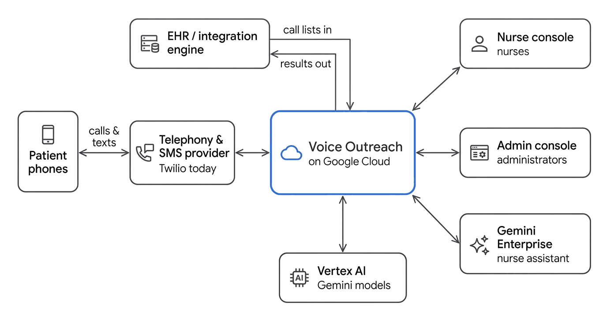

# Voice Outreach

Automated patient follow-up calls and texts, built on **Google ADK** and **Gemini Live**. It runs on **Cloud Run** with all infrastructure in **Terraform**.

**What it does:**
- **Calls patients** after a procedure, talks with them in natural speech, asks a short clinical questionnaire, and triages what it hears.
- **Puts every finding in front of a nurse,** ranked by urgency.
- **Texts patients it couldn't reach,** offering a call back or the same questions by text.

Out of the box it ships a **post-operative check-in**. Pre-operative readiness and other scenarios are added as configuration, not code.

> **Status: reference implementation.** It is built to be downloaded, adapted to your environment and tested. It is **not a medical device** and makes no clinical decisions on its own. Triage rules, wording and any automated answers must be reviewed and signed off by your clinical team before patients are contacted. Read [Safety and privacy](#safety-and-privacy) before going live.

---

## Contents
- [What it does](#what-it-does)
- [What it connects to](#what-it-connects-to)
- [Google Cloud services and what each is for](#google-cloud-services-and-what-each-is-for)
- [Components](#components)
- [The life of a call](#the-life-of-a-call)
- [Integrating with your environment](#integrating-with-your-environment)
- [Quick start](#quick-start)
- [Repository layout](#repository-layout)
- [Documentation map](#documentation-map)
- [Safety and privacy](#safety-and-privacy)
- [License](#license)

---

## What it does

**For patients**
- **A call at a sensible time,** in their preferred language, from a voice agent that introduces itself as automated.
- **Identity first:** the agent asks for the patient by name and verifies their date of birth before discussing anything health-related.
- **A short questionnaire:** how they feel, pain (0–10, where, better or worse), fever, the incision, swelling, sleep and, for diabetic patients, blood sugar. Then any questions they have for the care team.
- **Emergencies first:** every turn of the conversation is checked for emergency warning signs. If one is heard, the agent tells the patient to call 911 and ends the call.
- **A text if they're missed:** "1 = call me now, 2 = pick a time, 3 = answer by text." The same questionnaire works entirely over SMS.

**For nurses: the nurse console**
- **A work queue ranked by urgency:** emergency, same day, next business day.
- **Each finding with its reason,** e.g. "pain 8/10, worsening; one-sided leg swelling".
- **The full record:** the patient's answers, a transcript (in the original language or translated to English), the call recording, and the text conversation.
- **Actions:** change the follow-up tier, sign off, place a new call.
- **The same work from Gemini Enterprise** through an assistant that shows interactive cards (A2A + A2UI).

**For administrators: the admin console**
- **Analytics:** call outcomes per period (completed by voice or by text, voicemail and texted, no answer, not completed), reach, what patients report, and nurse workload.
- **Scheduling:** call schedules and calling hours, patients (one at a time or by CSV), and authorized numbers with SMS consent.
- **Content and messaging:** text-messaging settings, an optional knowledge base for answering routine questions (off by default; shadow mode for evaluation), languages, branding, and company name.
- **Testing and oversight:** testing tools (a browser test call and a simulated text conversation that never sends a real text), call diagnostics, and an audit log of every configuration change.

**For your systems**
- **An EHR scheduling API** to load the day's call lists with no clicking.
- **A FHIR-shaped record** of every nurse-signed result, waiting in an outbox for your exporter.
- **A provider interface** so telephony and SMS can come from a provider other than Twilio.

---

## What it connects to



| External system | Direction | How |
|---|---|---|
| **Telephony and SMS provider** (Twilio today) | both ways | Outbound calls through the provider's REST API, with call progress via signed webhooks. Live audio over a bidirectional media WebSocket. Texts through the provider's API, with inbound texts via webhook. Other providers plug in through an adapter; see [Telephony and SMS providers](docs/TELEPHONY-PROVIDERS.md). |
| **EHR or integration engine** | in | Daily call lists via `PUT /api/v1/call-batches/{source}/{batch_id}`, authenticated as a Google service account. No API keys. |
| **EHR** | out | One FHIR-shaped record per nurse-signed call (a QuestionnaireResponse, plus a Task when resolved), in an outbox your exporter reads. |
| **Gemini Enterprise** | in | The nurse assistant, served over A2A, with A2UI cards. |
| **Staff browsers** | in | The nurse and admin consoles, behind Google Identity-Aware Proxy (two separate access lists). |

---

## Google Cloud services and what each is for


| Service | Used for |
|---|---|
| **Cloud Run** | Six services and one job (see [Components](#components)). Scale to zero is supported; set a minimum instance count for low first-call latency. |
| **Vertex AI: Gemini Live** (`gemini-3.8-live`) | The real-time voice conversation: speech in and out, turn-taking, interruptions, tool calls. 24 languages. |
| **Vertex AI: Gemini Flash** (`gemini-3.8-flash`, `gemini-2.5-flash`, `gemini-2.5-flash-lite`) | Reading free-text SMS replies; translating transcripts and texts; the nurse assistant; the optional knowledge-base classifier and drafter. |
| **Vertex AI: Gemini TTS** (`gemini-2.5-flash-tts`) | The pre-recorded voicemail message, per language. |
| **Vertex AI Search: Check Grounding** | Checking that a knowledge-base answer is supported by approved material before it can be spoken. Off unless the knowledge base is turned on. |
| **Firestore** (Native mode) | The operational database: calls, reports, transcripts, the call queue and schedules, text conversations, settings, the audit log and the EHR outbox. |
| **Cloud Storage** | Call recordings (stereo WAV; retention configurable, 90 days by default), voicemail clips, branding images. |
| **BigQuery** | De-identified analytics tables: an HMAC patient key, and no names, numbers, dates of birth or free text. |
| **Cloud Tasks** | Each dial, call-completion handling, follow-up text, translation and post-call check, with retries. |
| **Cloud Scheduler** | Starting scheduled runs (every minute), expiring stale text conversations, refreshing analytics. |
| **Identity-Aware Proxy** | Sign-in for the two consoles, each with its own access list. |
| **Secret Manager** | Provider credentials and signing keys. Never in code or Terraform state. |
| **IAM service accounts** | One identity per service. The private API checks the caller's identity route by route. |
| **Cloud Logging / Monitoring** | Structured logs with no answers or PHI, log-based metrics, alerts and an uptime check. |
| **Cloud Build / Artifact Registry** | Building and storing the container images. |

---

## Components

| Component | What it does | Inputs | Outputs | Exposure / who calls it |
|---|---|---|---|---|
| **voa-gateway** (`services/gateway`) | The telephony edge and the voice agent. Answers the provider's webhooks, holds the live media stream, runs the Gemini Live conversation (ADK) with its tools, records the call, plays the voicemail. | Provider webhooks (answer, status, answering-machine result, inbound SMS); the media WebSocket; the patient record for that call. | Reports, call updates, transcripts, timelines and recordings (Firestore, Cloud Storage); follow-up tasks. | **Public**, every route authenticated (provider signature or HMAC token). |
| **voa-api** (`services/api`) | The private REST API and business logic: call queue and schedules, dialling, the SMS conversation, nurse actions and sign-off, admin settings, the EHR scheduling API, task and cron handlers. | Requests from the consoles, the nurse agent, the EHR feed, Cloud Tasks and Scheduler. | Firestore records; outbound calls and texts through the provider; tasks; the EHR outbox. | **Private.** Cloud Run IAM, then a per-route role table (nurse UI, admin UI, nurse agent, ingest, tasks). |
| **voa-ui** (`ui/`, nurse build) | The nurse console. The browser only talks to its own server, which calls the API with its service identity. | Staff browsers. | API calls on the nurse's behalf. | **IAP**, the nurses list. |
| **voa-admin** (`ui/`, admin build) | The admin console: the same codebase built in admin mode, with analytics, scheduling, patients, authorized numbers, messaging, knowledge base, languages, branding, testing, diagnostics and audit. | Staff browsers. | API calls (configuration routes only this identity may use); analytics reads. | **IAP**, the administrators list. |
| **voa-nurse** (`services/nurse`) | The Gemini Enterprise assistant: an ADK agent with A2UI cards (work lists, call details, transcripts, recordings, sign-off). | A2A requests from Gemini Enterprise. | API calls; A2UI cards. | **Private**, Gemini Enterprise only. |
| **voa-analytics** + export job (`services/analytics`) | The job refreshes de-identified BigQuery tables from Firestore every 15 minutes. The service answers the admin console's analytics queries. | Firestore (job); the admin console (service). | BigQuery tables; the analytics summary JSON. | **Private**, admin console only. |
| **Shared packages** (`packages/`) | `voa_core`: domain logic (lifecycle, triage rules, report validation, SMS state machine, languages, store). `voa_providers`: provider interfaces and adapters. `voa_agents`: the ADK voice agent. `voa_knowledge`: the knowledge-base agent. | n/a | n/a | Libraries. |

**Use cases and languages are configuration.**
- Questions, wording, triage rules and what nurses see come from a use-case file: `config/campaigns/post_op.yaml`, with `pre_op.yaml` as an example.
- Translations come from language packs in `config/campaigns/i18n/`.
- See [Editing questions and languages](docs/EDITING-QUESTIONS.md).

---

## The life of a call


1. **Queue.** Patients arrive from the EHR scheduling API, a CSV import or a nurse's "New call". A run starts now or at a scheduled time.
2. **Dial.** One Cloud Task per patient checks calling hours, the patient's language, the allowlist and the budget, then asks the provider to place the call.
3. **Answer.** The provider connects the call's audio to the gateway. Answering-machine detection decides between a person and a voicemail.
4. **Verify.** The agent confirms it has the right person and checks the date of birth server-side (two attempts).
5. **Talk.** Gemini Live asks the questions. Deterministic parsers type each answer; rules from the use-case file decide the follow-up tier. Emergency warning signs are checked on every turn.
6. **Save.** The report, transcript, recording and a millisecond timeline are stored. Non-English calls are translated, and re-checked for safety on the translation.
7. **Follow up.** No answer, busy or voicemail sends a text: call me now, pick a time, or answer by text. Automatic retries are configurable.
8. **Review.** A nurse reviews, adjusts the tier if needed, and signs off. Sign-off writes the FHIR-shaped record to the EHR outbox.

More detail: [Architecture](docs/ARCHITECTURE.md).

---

## Integrating with your environment


There are three integration points, each documented with examples.

| You want to… | Guide |
|---|---|
| **Load call lists from your EHR** and check what happened to each patient (Python examples) | [Integrating with your environment §1–2](docs/INTEGRATION-GUIDE.md#1-calls-in-loading-call-lists) |
| **Send results back to your EHR** (outbox exporter, FHIR or HL7) | [Integrating with your environment §3](docs/INTEGRATION-GUIDE.md#3-results-out-sending-results-to-your-ehr) |
| **Use your own telephony or SMS provider** (Cisco, Avaya, Genesys or another PBX, SBC, CCaaS or SMS gateway) | [Telephony and SMS providers](docs/TELEPHONY-PROVIDERS.md) |

**Example:** load tomorrow's morning list from Python, running as the ingest service account:

```python
import google.auth.transport.requests, google.oauth2.id_token, requests

API = "https://voa-api-<hash>-<region>.a.run.app"  # your private API URL
token = google.oauth2.id_token.fetch_id_token(google.auth.transport.requests.Request(), API)

batch = {
    "tranches": [
        {
            "label": "Morning",
            "scheduled_for": "2026-11-03T10:00:00-05:00",
            "campaign": "post_op",
            "calls": [
                {
                    "external_id": "enc-1001",
                    "mrn": "A1234567",
                    "name": "Jordan Rivera",
                    "dob": "1950-03-15",
                    "phone": "+12025550123",
                    "language": "es-US",
                    "procedure": "Total knee replacement",
                    "procedure_date": "2026-11-01",
                }
            ],
        }
    ]
}

r = requests.put(
    f"{API}/api/v1/call-batches/epic-prod/2026-11-03",
    json=batch,
    headers={"Authorization": f"Bearer {token}"},
    timeout=60,
)
r.raise_for_status()
for item in r.json()["items"]:
    print(item["external_id"], item["status"], item.get("reason"))
```

---

## Quick start

**You need:** a Google Cloud project with billing, `gcloud`, `terraform ≥ 1.9`, `uv`, Node 22+, and Python 3.13 (installed by `uv`).

```bash
git clone <this repo> && cd voice-outreach
make setup          # dependencies and git hooks (PII scan, secret scan, ruff, terraform fmt)
make test           # ~2,000 unit tests, no cloud needed
```

**Run it in your project.** Full steps are in [Deploy](docs/DEPLOY.md):

```bash
cp config/site.example.yaml config/site.yaml                       # project id, org name, timezone
cp infra/envs/demo/terraform.tfvars.example infra/envs/demo/terraform.tfvars
make bootstrap ENV=demo                                            # state bucket, APIs, identities, data stores
make deploy ENV=demo SERVICES="gateway api ui admin nurse analytics"
make smoke ENV=demo                                                # end-to-end checks, incl. a spoken test call
```

**You can evaluate it without any telephony account.** The admin console's **Testing** section places a test call from your browser through the real voice agent, and simulates a text conversation that never sends a real text.

**Evaluate the agent:**
- `make eval-voice` runs simulated patients through the real Gemini Live agent, in English and Spanish.
- `make eval-languages` runs the non-English safety set.
- `make eval-knowledge` runs the knowledge-base set.

---

## Repository layout

| Path | What |
|---|---|
| `services/gateway` | Telephony edge and the live voice session |
| `services/api` | Private API, task and cron handlers, SMS, EHR scheduling API |
| `services/nurse` | Gemini Enterprise nurse assistant (A2A + A2UI) |
| `services/analytics` | Analytics export job and summary service |
| `ui/` | Next.js nurse and admin consoles (one codebase, two builds) |
| `packages/voa_core` | Domain logic, with no vendor SDKs |
| `packages/voa_providers` | Telephony and SMS interfaces and adapters (the only place vendor SDKs live) |
| `packages/voa_agents` | The ADK voice agent and its tools |
| `packages/voa_knowledge` | The knowledge-base agent |
| `config/` | Use cases (`campaigns/`), language packs (`campaigns/i18n/`), language keyword lists, app defaults. Identifying values live only in gitignored files. |
| `infra/` | Terraform modules and per-environment roots |
| `evals/` | Simulated-patient voice evaluations |
| `scripts/` | Build, deploy, secrets, PII scanner, sample EHR feed, end-to-end checks |
| `docs/` | Documentation (see below) |

---

## Documentation map

| Read this | When |
|---|---|
| [Architecture](docs/ARCHITECTURE.md) | You want the full picture: services, data, one call end to end, security model |
| [Integrating with your environment](docs/INTEGRATION-GUIDE.md) | You're connecting an EHR: loading call lists, checking results, exporting results |
| [Telephony and SMS providers](docs/TELEPHONY-PROVIDERS.md) | You need a provider other than Twilio |
| [EHR scheduling API reference](docs/INGEST-API.md) | The exact contract of `/api/v1/call-batches` |
| [Deploy](docs/DEPLOY.md) | Standing up a new environment |
| [Runbook](docs/RUNBOOK.md) | Operating it: logs, alerts, troubleshooting |
| [Configuration reference](docs/CONFIG.md) | Every configuration key and environment variable |
| [Editing questions and languages](docs/EDITING-QUESTIONS.md) | Changing wording, questions, triage rules or translations |
| [Design notes](docs/README.md#design-notes) | Why things are the way they are: use cases, languages, knowledge base, analytics, admin |

---

## Safety and privacy

**Clinical safety**
- **Deterministic triage.** Follow-up tiers come from rules in the use-case file and from reviewed code, not from the model's judgement. Every rule needs clinical sign-off.
- **Emergencies.** Emergency warning signs are checked on every turn, by the model and, for texts and translated transcripts, by keyword rules too. The patient is told to call 911, and the call is flagged for nurses. The system does not call emergency services itself.
- **No medical advice.** The agent never gives medical advice. The optional knowledge base answers only routine, approved questions; medication and symptom questions always go to a nurse.
- **Other languages.** Answers in other languages are normalised to English with safeguards that can only raise urgency. Translations of patient-facing wording must be reviewed by a qualified medical translator before use.

**Privacy**
- **PHI minimisation:**
  - the date of birth travels only with the call that needs it;
  - logs carry identifiers and field names, never answers;
  - analytics is de-identified.
- **Your responsibilities:** HIPAA, a BAA with Google Cloud and with your telephony provider, SMS consent and carrier registration (A2P 10DLC in the US), calling-hours rules, and language-access requirements are the deploying organisation's responsibility.

**This repository** contains no patient data and no real configuration. A PII scanner runs on every commit and in CI. Report security issues as described in [SECURITY.md](SECURITY.md).

---

## License

Apache License 2.0. See [LICENSE](LICENSE) and [NOTICE](NOTICE).
