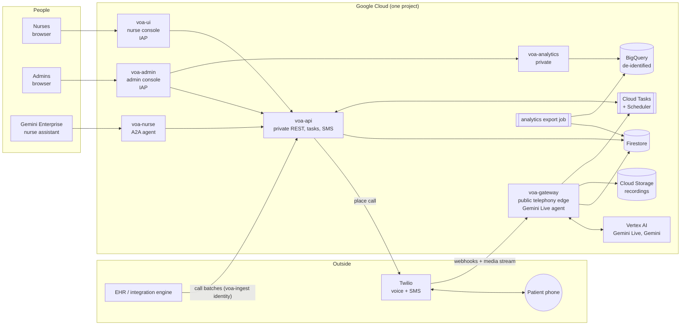
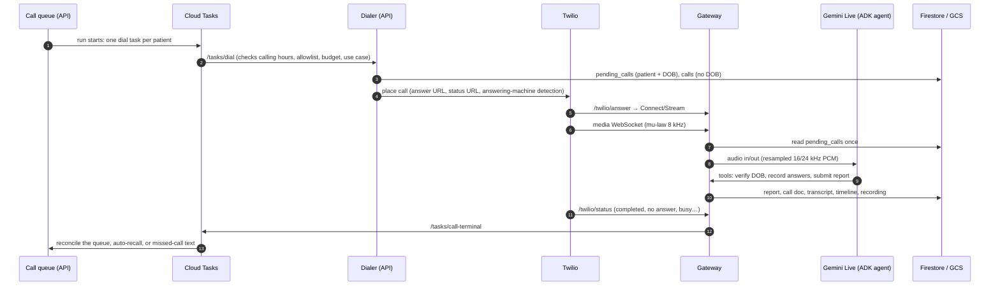

# Architecture

**What this system does:** it calls patients after a procedure, talks with them by voice, records their answers, triages anything that needs a nurse, and follows up by text when they don't answer. Nurses work from a web console and from a Gemini Enterprise assistant.

**Built with:** Google ADK on Gemini Live, running on Cloud Run, with the infrastructure in Terraform. Telephony is Twilio today, behind a provider interface (see `docs/INTEGRATION-GUIDE.md`).

This page is the map. Detail lives in:

| Topic | Doc |
|---|---|
| Plug in another telephony provider, feed the call queue from an EHR, send results back | `docs/INTEGRATION-GUIDE.md` |
| Deploy into an empty GCP project | `docs/DEPLOY.md` |
| Operate it (logs, troubleshooting) | `docs/RUNBOOK.md` |
| Every configuration key | `docs/CONFIG.md` |
| The EHR scheduling API contract | `docs/INGEST-API.md` |
| Edit the questions, wording and triage | `docs/EDITING-QUESTIONS.md` |
| Add a new use case (e.g. pre-op) | `docs/USE-CASES-PLAN.md` |
| Knowledge base and grounded answers | `docs/KNOWLEDGE-PLAN.md`, `docs/KNOWLEDGE-API.md` |
| A visual walk-through of a call | `docs/architecture.html` |

## 1. The pieces

### Services

| Service | Job | Exposure | Who may call it |
|---|---|---|---|
| **voa-gateway** (`services/gateway`) | Telephony edge. Twilio webhooks, the bidirectional media WebSocket, the Gemini Live voice agent (`CallSession`), call recording, signed recording links, and the browser softphone for testing. | Public. Every route authenticates its caller: Twilio signature, or an HMAC token. | Twilio; test browsers holding a token. |
| **voa-api** (`services/api`) | Private REST API: call queue and runs, dialling (as Cloud Tasks), call records, nurse actions and sign-off, SMS follow-up, the EHR ingest API, admin settings, knowledge base, audit. | Private. Cloud Run IAM, then a per-route role table (`auth.ROUTE_POLICY`). | The nurse UI, admin UI, nurse agent, EHR ingest identity, and the Cloud Tasks / Scheduler identity, each limited to its own routes. |
| **voa-ui** (`ui/`, `APP_MODE=nurse`) | Nurse console: the call queue, call status, the patient drawer (answers, reasons, transcript, recording, texts, sign-off). | Identity-Aware Proxy (a nurses list). | People. Its server side (BFF) calls the API with its own identity. |
| **voa-admin** (`ui/`, `APP_MODE=admin`) | Admin console: analytics, schedules, patients, authorized numbers, messaging, knowledge base, display, branding, testing, call diagnostics, audit log. | IAP (an admins list). | People. |
| **voa-nurse** (`services/nurse`) | The nurse assistant in Gemini Enterprise: an ADK agent served over A2A, with A2UI cards. | Private. | Gemini Enterprise's service agent. |
| **voa-analytics** (`services/analytics`) | Read-only summary for the admin Analytics section. | Private. | The admin console only. |
| **analytics export** (Cloud Run Job) | Every 15 min: Firestore → de-identified rows → BigQuery. | n/a | Cloud Scheduler. |

### Shared code (uv workspace, Python 3.13)

| Package | Responsibility |
|---|---|
| `packages/voa_core` | Config; the Firestore and in-memory store; Cloud Tasks; the call lifecycle; report validation; review and sign-off (with the EHR payload); compliance (allowlist, calling hours); use-case specs, parsers and the rule engine; the SMS state machine; budgets. No vendor SDKs. |
| `packages/voa_providers` | **The only place vendor SDKs live.** Telephony interfaces (`base.py`), the Twilio adapter, the browser adapter, fakes, SMS providers, audio codecs. |
| `packages/voa_agents` | The ADK voice agent (instruction built from the use-case spec; tools `verify_identity`, `record_answer`, `record_patient_question`, `submit_report`, `end_call`) and the SMS time interpreter. |
| `packages/voa_knowledge` | The knowledge agent: classify a patient's question, answer from approved clinic material, check grounding. Off by default. |

### Data

| Store | What | Notes |
|---|---|---|
| Firestore `calls` | One document per call: status, outcome, follow-up tier and reasons, answers, nurse review | **No date of birth** (it is stripped). |
| Firestore `pending_calls` | The patient details for one call, read once by the gateway at connect | The only place DOB travels with a call. |
| Firestore `reports`, `transcripts`, `call_events` | The filed report, the turn-by-turn transcript, and a millisecond timeline | |
| Firestore `call_list`, `call_runs`, `list_runs`, `call_batches`, `ingest_keys` | The call queue: who to call, when, and from which EHR batch | |
| Firestore `sms_*`, `scheduled_callbacks` | Text conversations, consent, opt-outs, booked callbacks | |
| Firestore `ehr_outbox` | One FHIR-shaped record per signed-off call, waiting for an exporter | See the integration guide, §3. |
| Firestore `settings`, `call_settings`, `audit_log`, `knowledge_*`, `outbound_allowlist` | Admin configuration and its audit trail | |
| Cloud Storage `<project>-voa-recordings` | `recordings/{call_id}.wav`: stereo, caller left and agent right, 8 kHz | Retention 90 days by default. |
| BigQuery `voa_analytics` | `fact_calls`, `fact_reasons`, `fact_questions` | De-identified: an HMAC patient key; no names, numbers, DOB or free text. |
| Secret Manager | Twilio credentials, the softphone token key, the analytics hash key | Never in Terraform state. |

## 2. One call, end to end

**The steps, with code locations:**
1. **Queue.** Entries reach `call_list` through:
   - the admin console (one at a time, or CSV import);
   - the EHR ingest API (`PUT /api/v1/call-batches/...`);
   - a nurse's "New call".

   Each entry carries the patient, the use case (`campaign_id`), and the preferred `language` (one of 24, default `en-US`) with `call_in_english`; a patient whose language is not callable yet is held, not dialled (`voa_core/languages.py`).

   A run, started now or scheduled with Cloud Scheduler checking every minute, creates one Cloud Task per patient (`routes_tasks.enqueue_dials`).
2. **Dial.** The task runs `dialer.dial`, which:
   - checks calling hours, the use case, the allowlist and the budget;
   - stores the patient for the gateway;
   - asks the voice provider to place the call, with per-call answer and status URLs.

   Code: `services/api/src/voa_api/dialer.py`.
3. **Answer.** Twilio fetches `/twilio/answer`, which returns TwiML connecting a bidirectional media stream to `wss://gateway/twilio/media`.
4. **Conversation.** `CallSession` (`services/gateway/src/voa_gateway/session.py`):
   - reads the patient once;
   - starts an ADK live session on Gemini Live, with the instruction built from the call's use-case spec (`config/campaigns/<id>.yaml`);
   - streams audio both ways, handling barge-in (`clear`), the answering-machine verdict and the voicemail drop;
   - records the call.

   The agent's tools verify the DOB server-side, parse every answer with deterministic parsers, triage with the spec's rules, and validate the report before the agent may say goodbye.
5. **Persist.** The gateway writes the report, call doc, transcript, timeline and recording directly (`persist.py`), then queues `/tasks/transcript-translate`: the API adds an English translation to every non-English turn (Gemini flash, `voa_api/translation.py`), sets `language_used` on the call, and leaves the original words, the triage and the answers untouched.
6. **Status.** Twilio's status callbacks map to provider-neutral lifecycle events (`voa_core/lifecycle.py`). A terminal status queues `/tasks/call-terminal`, which:
   - updates the queue entry and the run;
   - may schedule an automatic retry;
   - for no answer, busy or voicemail, sends the missed-call text (`sms_service.py`). A patient can complete the same questionnaire by text, and that report files onto the original call.
7. **Nurses.**
   - The console shows the call live (server-sent events): follow-up tier and reasons, answers, transcript and recording.
   - A nurse may change the tier, then signs off. Sign-off writes the FHIR-shaped record to `ehr_outbox`.
   - The Gemini Enterprise assistant offers the same actions in chat.

## 3. Security model

**Who can reach what**
- **Three ways in:**
  - the gateway (public, every request authenticated by signature or token);
  - the two consoles (behind IAP, two separate access lists);
  - the nurse agent (Gemini Enterprise only).
- **The API is private.** It checks the calling service's identity against a role table route by route: a nurse console can't change configuration, and the EHR feed can only manage call batches.
- **No API keys.** Machine callers are Google service accounts. An integration outside Google Cloud uses Workload Identity Federation to act as one.

**Data protection**
- **PHI minimisation:**
  - DOB lives only in `pending_calls` for the life of one call.
  - Analytics is de-identified.
  - Logs carry ids and field names, never answers.
- **Every configuration change is in the audit log,** with who made it and when.
- **The repository holds no PHI and no real configuration:** `config/site.yaml` and `terraform.tfvars` are gitignored, and a PII scanner runs on every commit and in CI.

## 4. Where to change things

| You want to… | Change |
|---|---|
| Edit questions, wording or triage for a use case | `config/campaigns/<id>.yaml` (`docs/EDITING-QUESTIONS.md`) |
| Add a use case | A new spec (`docs/USE-CASES-PLAN.md`) |
| Change models or the voice | `config/app.yaml` → `models`, `voice` |
| Change calling hours, auto-recall, time format, company name, branding | Admin console |
| Use a different telephony provider | `packages/voa_providers` plus a gateway route (`docs/INTEGRATION-GUIDE.md`, §1) |
| Feed patients from an EHR | The ingest API (`docs/INTEGRATION-GUIDE.md`, §2) |
| Send results to an EHR | An `ehr_outbox` exporter (`docs/INTEGRATION-GUIDE.md`, §3) |
| Stand up another environment | A new `infra/envs/<env>` from the same modules (`docs/DEPLOY.md`) |
