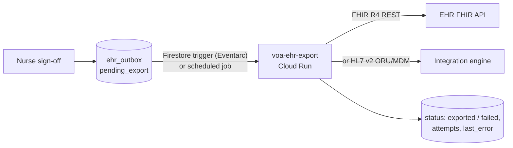

# Integration guide

This guide is for engineers connecting the system to their own environment. It covers three topics:

1. **Telephony.** How to run on a provider other than Twilio: an enterprise PBX, Cisco or another contact-center platform.
2. **Calls in.** How to fill the call queue from an EHR or any other system, with no clicking.
3. **Results out.** How to send call results (answers, triage, nurse sign-off, transcript, recording) back to an EHR.

Read `docs/ARCHITECTURE.md` first. Each section separates what is **built today** from what you would **build**.

---

## 1. Telephony: using a provider other than Twilio

### How telephony is abstracted

Vendor SDKs live only in `packages/voa_providers`. The rest of the system talks to three small interfaces in `packages/voa_providers/src/voa_providers/base.py`.

| Interface | Methods | Used for |
|---|---|---|
| `VoiceProvider` | `place_call(PlaceCallRequest(to, answer_url, status_url, amd)) -> PlacedCall(call_id, status)`; raises `ProviderRejected(code, message)` | Starting an outbound call. `hangup(call_id)` and `answer_response(...)` exist but the current code does not call them. |
| `MediaSession` | `codec`; `frames()` yields `StreamStart`, `Audio`, `MarkAck`, `Dtmf` or `StreamStop`; `send_audio(bytes)`; `mark(name)`; `clear()`; `close()` | The live, two-way audio for one call. |
| `SmsProvider` (`sms.py`) | `send(to, body) -> message_id`; raises `SmsSendError(code, permanent, opted_out)` | Missed-call texts and the text questionnaire. Optional. |

**What the conversation depends on:**

- **Two-way, real-time audio.** The gateway converts whatever the provider sends to the model's format, and back (`voa_providers/audio.py`). Supported today: mu-law 8 kHz (Twilio) and PCM16 16/24 kHz (the browser softphone). Add a `Codec` if yours differs.
- **Playback acknowledgement (`mark` → `MarkAck`).** The agent hangs up only after its last words have actually played. Without it, the goodbye gets cut off.
- **Flush (`clear`).** When the patient interrupts, queued agent audio is dropped immediately.
- **Hang up by closing the stream (`close`).**
- **Call progress events:** ringing, answered, completed, no answer, busy, failed. The provider's own events must be mapped onto the neutral `lifecycle.CallEventKind`.
- **Optional: answering-machine detection.** Write `answered_by` on the call (`human`, or `machine_*`) and the gateway plays the voicemail. Without it, set `amd.enabled: false`; the agent then recognises a voicemail greeting itself, which is less reliable.
- **Not needed from the provider:**
  - Recording: the gateway records its own stereo WAV.
  - TTS and speech recognition: Gemini Live does both.

### Three ways to connect enterprise telephony

| Option | What you do | Code change | When to choose it |
|---|---|---|---|
| **A. Keep Twilio as the media edge; bring your numbers or PBX over SIP** | Connect your carrier, PBX or SBC to Twilio with a SIP trunk (Twilio Elastic SIP Trunking or "bring your own carrier"), and call from your own numbers. | None | You need your enterprise caller ID or routing but can keep a cloud media edge. Fastest. |
| **B. A media server you run, on your SIP trunk** | Put a programmable media server between your SIP infrastructure and the gateway, e.g. Asterisk (ARI to originate, AudioSocket for audio), FreeSWITCH (ESL to originate, a WebSocket audio module), or jambonz. It originates the call and streams the call's audio to the gateway over a WebSocket. | A new adapter (below) | Calls must stay on your network and your PBX is SIP-capable. This is the usual path for Cisco CUCM or other SIP PBXs: a SIP trunk to the media server. |
| **C. A contact-center platform's own streaming API** | If your CCaaS platform can deliver a call's audio as a real-time, **bidirectional** stream and originate calls through an API, write an adapter for it. Check this capability with the vendor: many platforms stream audio *out* for analytics but can't play audio *back in*. | A new adapter | The calls must originate inside that platform: its queues, its reporting, its numbers. |

### Writing a new adapter (options B and C)

1. **Voice provider.** Create `voa_providers/<name>.py` with `class <Name>Voice(VoiceProvider)`. `place_call` originates the call through your platform's API and returns its call id.
   - The call must, once answered, connect its audio to the gateway's WebSocket URL for your adapter.
   - It must report progress to a status URL.
   - Map rejections to `ProviderRejected`.
2. **Media session.** `class <Name>MediaSession(MediaSession)` speaks your media server's stream protocol:
   - Emit `StreamStart(stream_id, call_id, params)` first, then `Audio(bytes)` frames in your codec, and `StreamStop` at the end.
   - `send_audio` writes playout audio.
   - `mark`/`MarkAck`: if your protocol has no playout acknowledgement, emulate it. Track the bytes sent and the elapsed time, and emit `MarkAck` once the audio queued before the mark has had time to play.
   - `clear` must drop queued audio.
   - `close` must end the call.
   - **Template:** `browser.py` (the softphone adapter) is a complete, small second implementation. `twilio.py` (`TwilioMediaSession`) is the production one.
3. **Gateway routes.** In `services/gateway/src/voa_gateway/app.py`, add:
   - the answer or connect step your platform needs (Twilio's is `/twilio/answer` returning TwiML);
   - the media WebSocket route that wraps the socket in your `MediaSession` and runs `CallSession` (copy `/twilio/media`);
   - a status webhook that maps your events with `lifecycle.call_event_patch` and queues `/tasks/call-terminal` on a terminal state (copy `/twilio/status`).

   **Every public route must authenticate its caller,** e.g. with a signature, mutual TLS or a token. The gateway is the only public service.
4. **Selection.**
   - Add your name to `TelephonyConfig.voice_provider` (`voa_core/config.py`).
   - Build it in the API's `context._build_voice`.
   - Choose it with `VOA__TELEPHONY__VOICE_PROVIDER`.
   - Add its secrets to `infra/envs/<env>/main.tf` (module `secrets`), never as plain env values.
5. **SMS** (optional): implement `SmsProvider.send` and an inbound-message route like `/twilio/sms`, or keep Twilio for texts only.
6. **Test.**
   - Use the fakes (`fake.py`) for unit tests.
   - `make eval-voice` runs simulated patients through the real Gemini Live agent; point it at your adapter's audio format.
   - Then place real calls to test handsets on the authorized-numbers list.

### Twilio-specific code outside the provider package

These places still assume Twilio and need generalising when a second provider lands. Each is small:

| Where | Assumption |
|---|---|
| `gateway/app.py`: `signed_form`, the media WebSocket | `X-Twilio-Signature` validation; the auth token from `providers.twilio` |
| `gateway/app.py` `/twilio/answer` | TwiML built inline (`<Connect><Stream>`) |
| `gateway/app.py` `_TWILIO_KIND`, `/twilio/status` | Twilio status names and form fields (`CallSid`, `CallStatus`, `AnsweredBy`, `ErrorCode`…) |
| `voa_core/config.py` AMD settings, `session.py` | Twilio's AMD mode names and `AnsweredBy` values (`machine_end_beep`…) |
| `api/dialer.py` | Answer and status URLs hard-coded as `/twilio/answer` and `/twilio/status`; caller ID read from `providers.twilio.from_number`; Twilio error codes treated as non-retryable |
| `api/context.py` `CALL_ID_RE`, `gateway/app.py` | Call ids assumed to be Twilio's `CA` + 32 hex |
| `sms_service.py` | Twilio error texts in messages to staff; inbound fields `MessageSid`, `From`, `Body` |
| Infrastructure | Twilio secrets and `VOA__PROVIDERS__TWILIO__*` env |

---

## 2. Calls in: filling the call queue programmatically

### Built today: the EHR scheduling API (recommended)

`PUT /api/v1/call-batches/{source}/{batch_id}`. The full contract is in `docs/INGEST-API.md`.

```json
{
  "tranches": [
    {
      "label": "Morning",
      "scheduled_for": "2026-10-22T10:00:00-04:00",
      "campaign": "post_op",
      "calls": [
        {"external_id": "enc-123", "mrn": "A1234567", "name": "First Last",
         "dob": "1950-03-15", "phone": "+13145550123",
         "procedure": "Total knee replacement", "procedure_date": "2026-10-20",
         "is_diabetic": false, "care_setting": "outpatient"}
      ]
    }
  ]
}
```

- **One batch is a day's list** (or any unit you choose). Each **tranche** becomes a scheduled call run that dials at `scheduled_for`, within the clinic's calling hours, with the normal retries and missed-call texts.
- **Idempotent:**
  - Sending the same batch again changes nothing.
  - Patients upsert on `(source, external_id)`.
  - A patient missing from a re-sent batch is cancelled, if not yet called.
- **Per-item results:** each patient comes back as `created`, `updated`, `unchanged`, `cancelled`, or `rejected` with a reason. One bad record never fails the batch.
- **Use case:** `campaign` on a tranche or a call (e.g. `post_op`, `pre_op`), checked against `config/campaigns/`.
- **Reconcile and withdraw:**
  - `GET` the same path returns each item's queue status and attempt count.
  - `DELETE` cancels what hasn't been dialled.
- **Limits:** 20 tranches, 500 calls per batch.

### Authentication

There are no API keys. The API accepts only Google-signed identity tokens and checks the caller's service account against a role table.

- **Inside Google Cloud** (Cloud Run job, GKE, Composer…): run as the `voa-ingest` service account and request an ID token for the API's URL. Example: `scripts/sample_ehr_feed.py`.
- **Outside Google Cloud** (an on-prem integration engine such as Rhapsody, Cloverleaf, Mirth or Epic Bridges, or another cloud): use **Workload Identity Federation** to exchange your platform's identity (OIDC, AWS, Azure, or a certificate) for a short-lived token as `voa-ingest`.
  - **Not built yet:** the federation pool and provider are not in Terraform. Add them per environment.
- **Scope:** `voa-ingest` may call only the `/api/v1/call-batches` routes. It can't read calls or change configuration.

### Typical feed patterns

| EHR side | How it reaches the API |
|---|---|
| HL7 v2 ADT (A03 discharge) through an integration engine | The engine collects the day's discharges, maps them to a batch, and PUTs it once or several times a day. Re-sending is safe. |
| FHIR R4 (Encounter/Procedure search) | A small scheduled job queries discharges and procedures since the last run, and PUTs a batch. |
| A nightly extract (CSV/SFTP to Cloud Storage) | A Cloud Run job, triggered by the file landing, converts it and PUTs a batch. |
| Bursty or unreliable feeds | A Pub/Sub topic with a push subscription to the same endpoint, and a dead-letter topic (planned, not built). |

### Other ways in

- **Admin console → Patients:** add one patient, or import a CSV (columns `phone, patient_name, patient_id, patient_dob, operation_name, operation_date, is_diabetic, care_setting`). Then start or schedule a run under Schedules.
- **Nurse console → New call:** one patient, dialled now.
- **`/api/call-list` REST routes:** these belong to the consoles' identities, not to integrations. Use the ingest API.

### Known gaps
- `language` is accepted on ingest calls but not stored or used yet.
- The CSV import has no use-case (`campaign_id`) column.

---

## 3. Results out: sending call data back to an EHR

### What exists for every call

| Data | Where | Contents |
|---|---|---|
| Call record | Firestore `calls/{call_id}` | Times (ringing, answered, ended); call status (completed, voicemail, no answer, busy, failed); outcome (questionnaire completed, voicemail left, wrong person, identity not verified, declined, call back later, emergency); use case and spec version; how it was placed (run, EHR batch, nurse) and its queue entry. **No DOB.** |
| Answers | `calls.survey_responses` | Each question's normalised answer (e.g. `pain_severity: 7`), the patient's own words for free-text questions, and the patient's questions to the care team with category and priority. |
| Triage | `calls.follow_up`, `follow_up_reason`, `follow_up_reasons[]` | Tier (emergency, urgent same day, next business day, informational, none), plus every finding with its own tier and source. |
| Nurse review | `calls.review`, `follow_up_override`, `follow_up_history` | Sign-off (who, when, note), any tier change by a nurse, resolution. |
| Report | Firestore `reports/{patient_id}_{timestamp}` | The validated report as filed by the agent, voice or text. |
| Transcript | Firestore `transcripts/{call_id}` | Turns `{role, text, at_ms}`. |
| Recording | `gs://<project>-voa-recordings/recordings/{call_id}.wav` | Stereo WAV, caller on the left, agent on the right. Retention 90 days by default. |
| Timeline | Firestore `call_events/{call_id}` | Millisecond events (engineering). |
| Texts | Firestore `sms_sessions`, `sms_messages` | The missed-call text, the questionnaire by text, booked callbacks. |
| **EHR outbox** | Firestore `ehr_outbox/{call_id}` | **One FHIR-shaped record per signed-off call.** See below. |

### Built today: the EHR outbox

When a nurse signs off a call (`POST /api/calls/{id}/sign-off`), the API writes `ehr_outbox/{call_id}`. Code: `voa_core/review.py` `ehr_payload`.

```json
{
  "call_sid": "CA…",
  "patient":   {"mrn": "A1234567", "name": "First Last"},
  "encounter": {"date": "2026-10-21T14:05:12Z", "channel": "phone", "identity_check": "verified"},
  "questionnaire_response": {
    "resourceType": "QuestionnaireResponse", "status": "completed",
    "item": [{"linkId": "pain_severity", "answer": 7}, {"linkId": "fever_reported", "answer": "no"}]
  },
  "disposition": {"follow_up": "urgent_same_day", "reason": "Patient reports pain 7/10 …",
                  "agent_follow_up": "urgent_same_day", "changed_by_nurse": null},
  "review": {"status": "signed_off", "by": "nurse@example.org", "at": "…", "note": "…", "resolved": true},
  "task": {"resourceType": "Task", "status": "completed", "description": "Post-op RN follow-up",
           "note": "…", "owner": "nurse@example.org", "lastModified": "…"},
  "status": "pending_export",
  "created_at": "…"
}
```

- `task` is present only when the nurse resolved the follow-up.
- `status` becomes `withdrawn` if the sign-off is reopened, or if a later report replaces this one.
- The outbox never contains the date of birth.

**Not built:** nothing reads the outbox yet, and there is no API for it. That is the integration point to build.

### Recommended: an outbox exporter



**How the exporter should behave:**

1. **Trigger:** on each new or changed `ehr_outbox` document (an Eventarc Firestore trigger), or every few minutes, query `status == "pending_export"`.
2. **Map.** Map the record to your EHR's format:
   - **FHIR R4:**
     - `QuestionnaireResponse`, with `subject` = the patient (resolved by MRN) and `questionnaire` = your canonical post-op questionnaire. Map each `linkId` to your questionnaire's item ids; the ids come from the use-case spec (`config/campaigns/<id>.yaml`).
     - `Task` for the nurse follow-up.
     - Optionally a `Communication` or `DocumentReference` for the call summary.
   - **HL7 v2:** an ORU^R01 (observations) or MDM^T02 (a document with the summary) through your integration engine.
3. **Write back.** `status: exported`, the EHR's resource ids and the time. On failure: `status: failed`, `attempts`, `last_error`, retried with backoff.
4. **Idempotency.** Use `call_sid` as your external identifier (FHIR `identifier`, or an HL7 message control id) so a retry never creates a duplicate.
5. **Withdrawals.** A `withdrawn` record means the earlier export no longer stands. Mark it `entered-in-error` in FHIR, or send a correction.
6. **Identity.** Give the exporter its own service account with Firestore access and nothing else. Grant it EHR credentials through Secret Manager.

**Transcripts and recordings contain PHI.** Decide with your privacy office whether they go to the EHR at all. If they do:
- send the transcript as a `DocumentReference` (text attachment);
- send the recording as a `DocumentReference` whose attachment is copied into the EHR's own storage. Don't link to it: the system's recording links expire after 15 minutes, and recordings are deleted after the retention period.

### Other patterns (not built)

| Pattern | When | What to build |
|---|---|---|
| **Pull API** | The EHR side prefers to poll | `GET /api/v1/results?since=<cursor>` for the ingest identity: outbox records in order, with a cursor. Add it to the role table as FEED. Today `voa-ingest` can read only its own batches' queue status. |
| **Events** | Several consumers, real-time | Publish to Pub/Sub on "report filed" (`gateway/persist.py`, `sms_service.py`), "signed off" (`routes_calls.py` sign-off), and "call finished" (`/tasks/call-terminal`). Consumers subscribe. |
| **Results by batch** | The feed wants per-patient results for what it sent | Extend `GET /api/v1/call-batches/{source}/{batch_id}` with each item's latest call id, outcome, tier and sign-off status. |

### Which result to send, and when

- **Send after nurse sign-off, which is what the outbox does,** if the EHR record should reflect clinical review.
- **Send the agent's report immediately** (Pub/Sub on "report filed") if the EHR should show the raw answers before review. Mark them as unreviewed, patient-reported data.
- **Emergencies:** the agent sends the patient to 911 during the call, and nurses see the call at the top of the console. Do not rely on an EHR export for urgent escalation.
